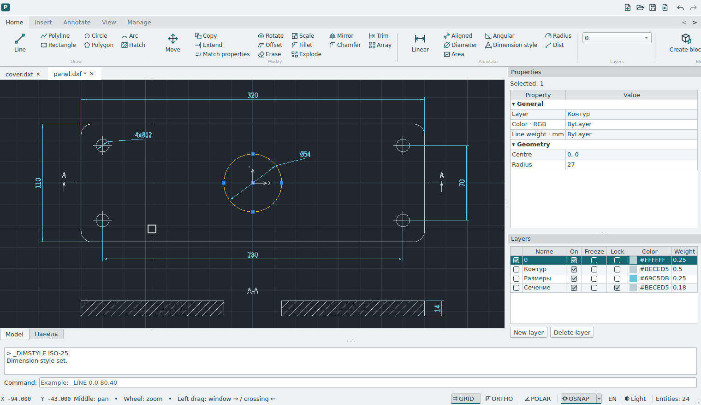
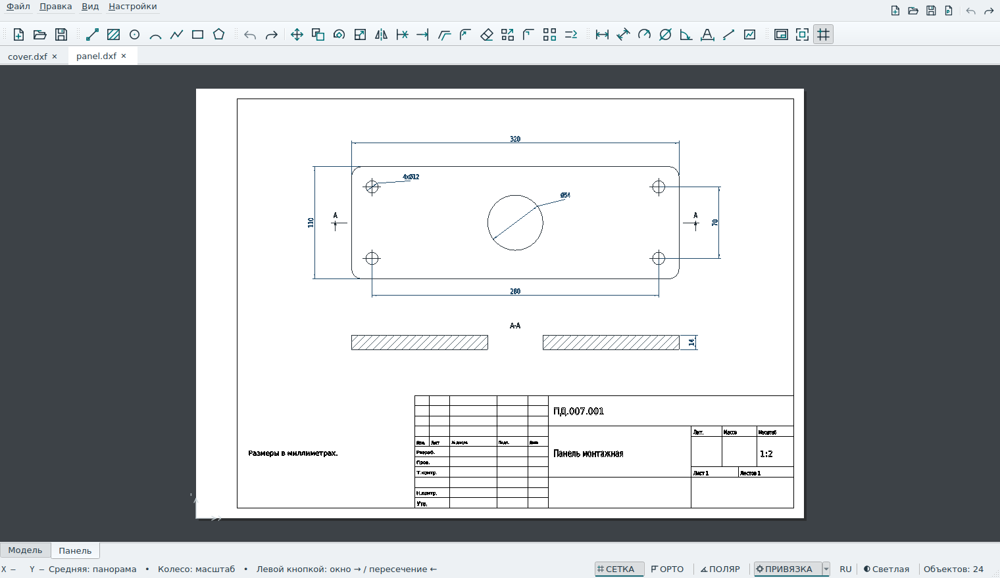
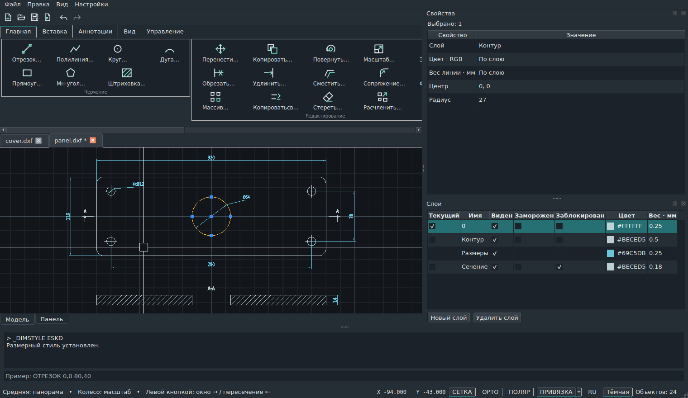
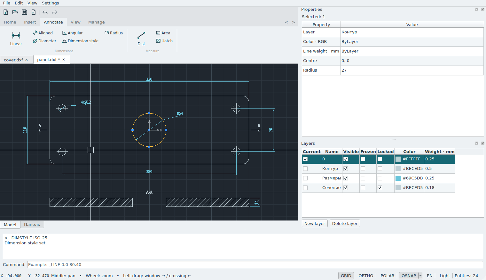
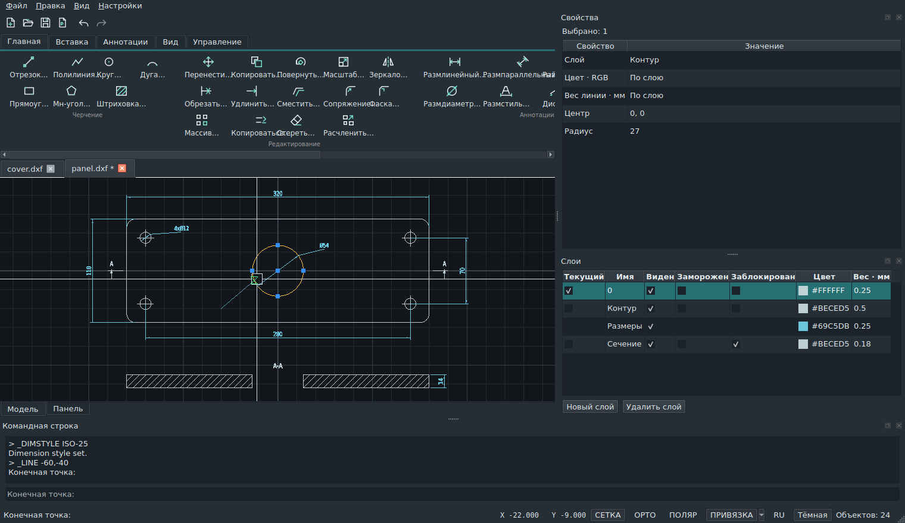
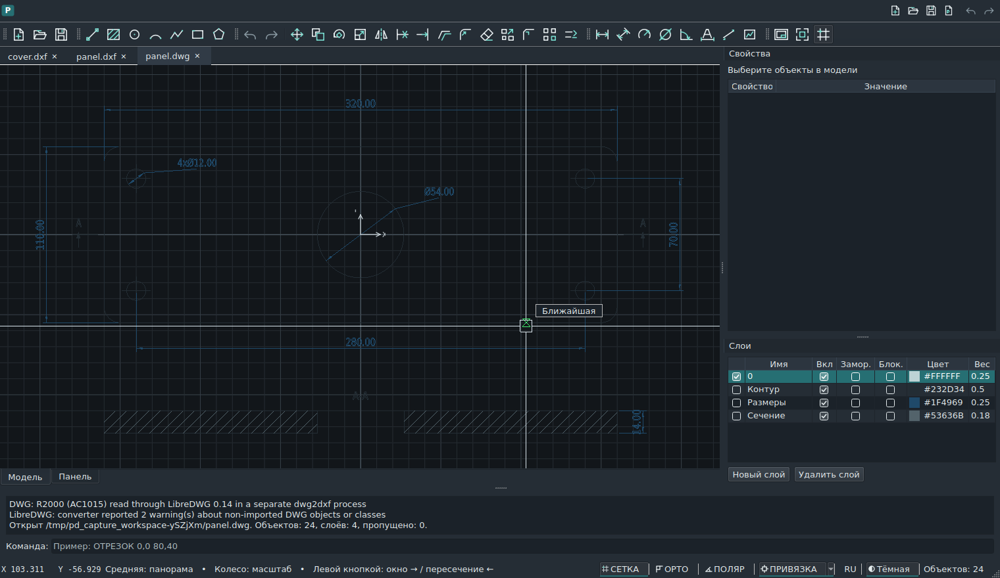

**English** · [Русский](README.ru.md)

[](https://github.com/Alchimon-Code/FreeCAD/actions/workflows/ci.yml) [](LICENSE) [](LICENSES/MIT.txt)   

# PlaneDraft 2D



PlaneDraft is a desktop drafting application for Windows x64 and Linux. Edit geometry in model space, arrange scale views on paper and produce a vector PDF from the same drawing — even on a machine without Qt or a GPU. This is an independent project hosted in `Alchimon-Code/FreeCAD`, not an upstream FreeCAD workbench.

**Try the drawing above:** open [panel.dxf](examples/drawings/panel.dxf), select the central circle and double-click **Radius** in Properties. Change it, then press **Ctrl+Z**. Switch from **Model** to **Панель** below the canvas: the 320 mm panel appears 160 mm wide on a landscape A4 sheet at 1:2. The original dimension still reads 320.

## From model to sheet

| In the drawing | What you can do |
|---|---|
| [Model and layers](docs/images/workspace-dark-ru.png) | Work with lines, circles, arcs, bulged polylines and text. Edit shared properties in one transaction; lock a layer without losing its snap points. Each document tab keeps its own camera, selection, command line and undo history. |
| [Precision editing](editor/README.md) | Pick before or during a command. Trim and extend using analytic intersections with finite line or circular edges. Offset a line, circle, arc or polyline; fillet two lines at a given radius. Drag grips; use endpoint, midpoint, centre, quadrant, intersection, insertion or nearest snaps. F3 toggles OSNAP, F8 Ortho, F10 polar tracking. |
| [Blocks and annotation](docs/DRAWINGS.md) | Reuse nested block definitions, insert or explode them. Hatch closed boundaries with islands. Place linear, aligned, radius, diameter and angular dimensions with ISO or ESKD settings. |
| [Paper space](docs/images/layout-eskd.png) | Lay out clipped viewports at explicit scales on A4–A1 sheets. Add a frame and an ESKD-style title block. Changing tabs doesn't alter the model. |
| [Output](docs/images/pdf-output.png) | Read and write the supported ASCII DXF subset. Export layers, colours and physical line weights to SVG or PDF. **DWG works out of the box:** open and save dialogs accept `*.dwg *.dxf`, and the pinned GPLv3 LibreDWG `dwg2dxf`/`dxf2dwg` programs ship under `tools/libredwg/` and run as separate processes — nothing to install and no environment variable to set. |
| [Workbench](editor/README.md) | A five-page ribbon (Home, Insert, Annotate, View, Manage) with a quick access toolbar and layer/colour/line-weight drop-downs, switchable to the classic toolbars from the View menu. Space confirms or repeats, F2 collapses or expands the command history, Ctrl+0 leaves just the drawing, a middle double-click zooms to extents, the right-button menu carries repeat, recent commands, clipboard and properties, and F12 shows dynamic length/angle input at the crosshair. |
| [Commands](editor/README.md) | Classic AutoCAD names with EN and RU aliases: `_RECTANG`/`ПРЯМОУГ`, `_POLYGON`/`МН-УГОЛ`, `_CIRCLE`, `_ARC`, `_PLINE`, `_CHAMFER`/`ФАСКА`, `_ARRAY`/`МАССИВ` (one undo step), `_MATCHPROP`/`КОПИРОВАТЬСВ`, `_DIST`/`ДИСТ`, `_AREA`/`ПЛОЩАДЬ`, plus `COPYCLIP`/`CUTCLIP`/`COPYBASE`/`PASTECLIP` on Ctrl+C/X/Shift+C/V. A user `aliases.ini` extends the built-in table. |
| [Extensions](sdk/README.md) | Load trusted C ABI modules explicitly, or run a [PlaneDraft Lisp script](examples/scripts/pattern.pdl). Both edit the active drawing through the same transaction mechanism. |



The v0.2.0 workbench, captured from the running application rather than drawn:

| Ribbon, dynamic input, DWG |
|---|
|  |
|  |
|  |
|  |

[Dark workspace in Russian](docs/images/workspace-dark-ru.png) · [PDF rendered at 144 dpi](docs/images/pdf-output.png) · [How these images were made](docs/images/README.md)

## Architecture & design rationale

* **One model, with no window attached.** [`pd_core`](core/README.md) depends on neither Qt nor OpenGL. The editor, file converter, test runner and extension host all use the same geometry and document invariants. The PDF exporter doesn't photograph the canvas.
* **Keep survey coordinates accurate.** The [renderer](render/README.md) computes `world − uploadOrigin` in CPU `double` *before* converting to `float32`. It also computes the origin-to-camera offset in double. Panning near `(10⁷, −10⁷)` doesn't subtract two already-rounded GPU coordinates or require double-precision shaders.
* **Undo the edit, not its arithmetic.** The document retains immutable entity versions (`shared_ptr<const T>`) keyed by stable handles. A transaction prepares replacements and forks the persistent R-tree, copying only changed index paths. Geometry, index and history are committed together. Undo restores prior values rather than applying an inverse transform; a rejected edit leaves the redo branch intact.
* **Extensions need a contract, not the host's C++ ABI.** The [v2 C interface](sdk/include/planedraft/pd_plugin_api.h) exchanges sized tables, POD values, opaque handles and owned snapshots; v1 modules remain supported. The built-in [PlaneDraft Lisp](scripting/README.md) doesn't require Python, Scheme or another external runtime.
* **Make distribution boundaries visible.** The host is [LGPL-2.1-or-later](LICENSE); the SDK and examples are [MIT](LICENSES/MIT.txt). Qt libraries are dynamically replaceable. The DWG bridge ships LibreDWG's GPLv3 `dwg2dxf`/`dxf2dwg` as separate executables under `tools/libredwg/` with their licence text: no LibreDWG code is linked into or loaded by the LGPL core. Process separation doesn't cancel third-party obligations. See [notices](THIRD_PARTY_NOTICES.md) and the [distribution checklist](docs/LICENSING.md).

## Quick start

Use a desktop OpenGL **4.5 Core** driver for the GUI. `pdconvert` and the headless tests don't need one. With the Windows portable ZIP, extract the **whole folder** and run `bin\PlaneDraft.exe`; the alternative is a per-user installer. To build the tagged sources instead:

```sh
git clone --depth 1 --branch v0.1.0 https://github.com/Alchimon-Code/FreeCAD.git PlaneDraft
cd PlaneDraft
```

### Windows · MSVC 2022 x64

Install **Desktop development with C++**, the Windows SDK, CMake ≥ 3.24, Ninja and Git. In **x64 Native Tools Command Prompt for VS 2022** (`cmd.exe`):

```bat
git clone https://github.com/microsoft/vcpkg.git ..\vcpkg
git -C ..\vcpkg checkout 84bab45d415d22042bd0b9081aea57f362da3f35
call ..\vcpkg\bootstrap-vcpkg.bat -disableMetrics
for %I in (..\vcpkg) do set "VCPKG_ROOT=%~fI"
cmake --preset windows-msvc
cmake --build --preset windows-msvc
ctest --preset windows-msvc
build\windows-msvc\bin\PlaneDraft.exe examples\drawings\panel.dxf
```

The first configure builds the pinned dependencies. `windows-core` builds without Qt. For portable ZIP and per-user Inno Setup instructions, see [Windows packaging](packaging/windows/README.md). DXF “Open with” registration is opt-in.

### Linux · GCC or Clang

Install a C++20 compiler, CMake ≥ 3.24, Ninja, GoogleTest and a Qt **6.5+** SDK with Widgets, OpenGL, OpenGLWidgets, Svg, LinguistTools and `qtbase_ru.qm`. Point `CMAKE_PREFIX_PATH` at the SDK if it's not on the system search path. To select Clang, set `CC=clang CXX=clang++` for the first configure in a fresh build tree.

```sh
cmake --preset linux-release
cmake --build --preset linux-release --parallel
ctest --preset linux-release
build/linux-release/bin/PlaneDraft examples/drawings/cover.dxf examples/drawings/panel.dxf
```

### Run a demo or issue a sheet

From `build/<preset>/bin/` or a packaged `bin/`, launch `PlaneDraft --viewport-demo` for a large-coordinate scene. `PlaneDraft --load-plugins` opts in to trusted modules in the sibling `plugins/` folder; enter `_FRAME 100`, then **Ctrl+Shift+E**. Without that flag the application doesn't scan the directory. To try scripting, use **File → Run script** and select [pattern.pdl](examples/scripts/pattern.pdl).

With the matching `bin` on `PATH`, from the project or package root:

```sh
pdconvert --layout "Панель" examples/drawings/panel.dxf panel-A4.pdf
pdconvert examples/drawings/cover.dxf cover.svg
```

[Exchange contract and DWG configuration](io/README.md) · [Printable example](docs/DRAWINGS.md). Unknown DXF records are reported; arbitrary third-party DXFs are **not** losslessly round-tripped. Hatches and dimensions are editable, not persistently constrained to neighbouring geometry.

## Verification & releases

[CI runs](https://github.com/Alchimon-Code/FreeCAD/actions/workflows/ci.yml) cover Linux GCC/Clang with real Mesa framebuffer readback (100%, 150%, 200%), headless ASan/UBSan and MSVC x64. The independent audit checks DXF structure and the physical scale of a rasterised vector PDF. For Windows the release gate includes a cold-PATH launch, conversion, installation/uninstallation and SHA-256 checks of **every** packaged runtime against `RUNTIME_INVENTORY.md`. A hosted runner is not a test of a workstation's graphics driver.

**Windows x64 v0.2.0: DWG works out of the box.** [All five CI jobs passed](https://github.com/Alchimon-Code/FreeCAD/actions/runs/44722807453). The Windows job ran the payload's own `dxf2dwg.exe` on the example drawing, exported `panel.dxf → .dwg → .dxf` and re-checked that every entity survived, with the converters found beside the executable and nothing on `PATH`. The inventory grew to **27 runtime files**: the previous 25 plus `tools/libredwg/dwg2dxf.exe` and `dxf2dwg.exe`, each paired with `LICENSES/LibreDWG-0.14-GPL-3.0.txt`. These two GPLv3 programs are built from the pinned tarball with MinGW-w64 — the MSVC build of the same encoder never returns — and are never linked into the LGPL host.

**Windows x64 v0.1.0: verified on MSVC 2022.** [All five CI jobs passed](https://github.com/Alchimon-Code/FreeCAD/actions/runs/44516861855). The [Windows job](https://github.com/Alchimon-Code/FreeCAD/actions/runs/44516861855/job/135535007043) launched the portable and installed copies with a clean `PATH`, exported the 297 × 210 mm sheet, tested opt-in DXF registration and uninstalled. The actual inventory had **25 runtime files**: 4 PlaneDraft binaries, 8 Microsoft CRT DLLs, 7 Qt 6.9.3 libraries (including Network and SVG), `qwindows.dll`, `qtbase_ru.qm`, and DLLs for double-conversion, libpng, PCRE2-16 and zlib. No GTest or DWG converter was shipped.

The [v0.2.0 draft release](https://github.com/Alchimon-Code/FreeCAD/releases/tag/v0.2.0) pairs `PlaneDraft-0.2.0-windows-x64.zip` and `PlaneDraft-0.2.0-windows-x64-setup.exe` with `SHA256SUMS` and `RUNTIME_INVENTORY.md` from their own build; the assets are copied from the verified run, never rebuilt. It stays a draft until the [distribution review](docs/LICENSING.md) is settled — preparing a draft does not bypass it.

[Changelog](CHANGELOG.md) · [Releases](https://github.com/Alchimon-Code/FreeCAD/releases) · [Architecture map](ARCHITECTURE.md) · [Contributing & tests](CONTRIBUTING.md)
