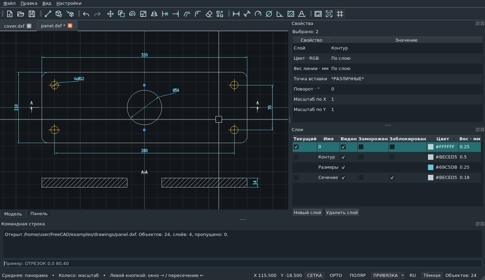

# PlaneDraft 2D

Независимая открытая 2D-САПР для Windows x64 и Linux: C++20, Qt 6 Widgets и настольный OpenGL 4.5 Core. Это новый проект в этом репозитории, не модуль и не сборка upstream FreeCAD.



На снимке открыт [пример панели](examples/drawings/panel.dxf). Для вида модели изменены цвета слоёв; `*` у имени файла отмечает несохранённое изменение. Выбраны две вставки с разными точками вставки. Сверху — вкладки **документов**, под холстом — **модель и листы** текущего чертежа.

**Попробуйте:** в новом чертеже введите `_LINE 0,0 80,40`, выберите отрезок и дважды щёлкните по его конечной точке в «Свойствах». Задайте `100,50`, затем нажмите `Ctrl+Z`: холст, числовое значение и пространственный индекс вернутся к прежнему состоянию. Если выбрано несколько объектов, изменение общего поля — один шаг отмены для всей группы.

[Выпуск чертежа: размеры, штриховка и листы](docs/DRAWINGS.md) · [Редактирование: команды, F8/F10 и ручки](editor/README.md) · [Дерево, архитектура и этапы](ARCHITECTURE.md) · [Объектное ядро и headless-тесты](core/README.md) · [Видовой экран: RTE, OSNAP, тест 100k](render/README.md) · [Обмен DXF/DWG и экспорт SVG/PDF](io/README.md) · [SDK расширений v2/v1](sdk/README.md) · [PlaneDraft Lisp](scripting/README.md) · [Лицензии и границы распространения](docs/LICENSING.md) · [Для участников](CONTRIBUTING.md)

## Рабочее место

* «Свойства» показывает пересечение доступных полей. Слой, цвет (по слою / по блоку / RGB) и вес линии доступны для смешанного выбора. Для подходящих объектов есть координаты и вершины, радиусы и углы, текст, параметры размера, поворот и масштабы вставки. Разные значения обозначаются `*РАЗЛИЧНЫЕ*` / `*VARIES*`.
* В «Слоях» отметьте текущий слой, чтобы рисовать на нём. Имя, цвет и вес редактируются двойным щелчком. Видимость, заморозка и блокировка независимы: к видимому заблокированному объекту можно привязаться, но нельзя сдвинуть его ручкой, `_MOVE` или удалить. Слой `0` и занятые слои удалить нельзя.
* В меню **Вид → Панели и инструменты** можно вернуть закрытый док или одну из пяти SVG-панелей: Файл, Рисование, Редактирование, Аннотации, Вид. Док можно переместить, отсоединить или объединить с другим. Положение окна и панелей восстанавливается при следующем запуске.
* Внизу — мировые X/Y, переключатели сетки (F7), Орто (F8), полярного отслеживания (F10) и привязок (F3). Стрелка или правая кнопка на «ПРИВЯЗКА» открывает выбор видов: конец, середина, центр, пересечение, ближайшая, квадрант, точка вставки. Рядом — RU/EN и светлая/тёмная тема без перезапуска.
* `Ctrl+N`, `Ctrl+O`, `Ctrl+W` — новый документ, открыть, закрыть вкладку. У каждого чертежа свои Undo/Redo, выбор, камера, активный слой, командная строка и лист. Закрытие изменённой вкладки или всего окна предлагает сохранить, отбросить изменения или отменить закрытие. Отмена **до точки сохранения** снимает `*`.

## Сборка на Windows

Нужны Visual Studio 2022 с **Desktop development with C++**, Windows SDK, CMake ≥ 3.24, Ninja и Git. Для запуска холста — драйвер OpenGL ≥ 4.5 (не только системный OpenGL 1.1). Для стандартных тестов видеокарта не нужна; отдельная проверка framebuffer требует рабочего GL-контекста.

Команды для **x64 Native Tools Command Prompt for VS 2022** (`cmd.exe`), из корня проекта. Пример установки vcpkg в соседнюю папку; если vcpkg уже установлен, задайте `VCPKG_ROOT` на checkout той же ревизии.

```bat
git clone https://github.com/microsoft/vcpkg.git ..\vcpkg
git -C ..\vcpkg checkout 84bab45d415d22042bd0b9081aea57f362da3f35
call ..\vcpkg\bootstrap-vcpkg.bat -disableMetrics
for %I in (..\vcpkg) do set "VCPKG_ROOT=%~fI"

cmake --preset windows-msvc
cmake --build --preset windows-msvc
ctest --preset windows-msvc
build\windows-msvc\bin\PlaneDraft.exe
```

Первый configure собирает зависимости и может занять значительное время. Preset выбирает Ninja, Release, динамический `x64-windows` и тесты GoogleTest. Портам и инструменту vcpkg задан один baseline; это фиксация версий зависимостей, а не обещание побитового совпадения для разных MSVC/Windows SDK. Qt DLL размещает vcpkg (app-local), платформенную `platforms/qwindows.dll` копирует CMake. Собственный перевод PlaneDraft встроен в exe; перевод стандартных диалогов Qt хранится отдельно в `bin/translations/qtbase_ru.qm`. Рабочий каталог не важен. Каталог `bin/` — дерево разработки. Для переносимой поставки используйте [CPack + windeployqt и Inno Setup](packaging/windows/README.md). ZIP и установщик содержат один и тот же комплект; регистрация `.dxf` необязательна.

## Сборка на Linux

Нужны C++20 (GCC или Clang), CMake ≥ 3.24, Ninja, GoogleTest, Qt **6.5+** с Core, Gui, Widgets, OpenGL, OpenGLWidgets, **Svg**, LinguistTools и каталогом `qtbase_ru.qm`. Версия Qt из дистрибутива может быть старше требуемой: укажите подходящий SDK через `CMAKE_PREFIX_PATH`. Для запуска нужен настольный OpenGL 4.5 Core.

```sh
# При необходимости: export CMAKE_PREFIX_PATH=/opt/Qt/6.9.3/gcc_64
cmake --preset linux-release
cmake --build --preset linux-release --parallel
ctest --preset linux-release
build/linux-release/bin/PlaneDraft examples/drawings/cover.dxf examples/drawings/panel.dxf
```

Для **полного** Release-прогона включите `-DPLANEDRAFT_TEST_GL=ON -DPLANEDRAFT_TEST_EXCHANGE_AUDIT=ON` при configure, установите `python -m pip install -r tests/requirements-audit.txt` в виртуальном окружении и запустите `ctest --preset linux-release` в GL-сессии (либо `LIBGL_ALWAYS_SOFTWARE=1 xvfb-run -a ctest --preset linux-release`). Независимый аудит и реальный framebuffer — не зависимости обычного приложения. Отдельная headless-проверка:

```sh
cmake --preset linux-sanitize -DPLANEDRAFT_TEST_EXCHANGE_AUDIT=ON -DPD_ENABLE_LIBREDWG=ON
cmake --build --preset linux-sanitize --parallel
ASAN_OPTIONS=detect_leaks=1:halt_on_error=1 UBSAN_OPTIONS=halt_on_error=1:print_stacktrace=1 ctest --preset linux-sanitize
```

Без тестов: `-DBUILD_TESTING=OFF`. Для сборки без Qt: `-DPLANEDRAFT_BUILD_GUI=OFF` или Windows preset `windows-core`. В [CI](.github/workflows/ci.yml) настроены задания для Linux GCC/Clang Release, headless Debug с санитайзерами и Windows MSVC 2022 x64. В Windows-задание включены сборка и проверка обоих пакетов без публикации релиза.

**Статус проверки шага 8.** На Linux с Qt 6.5 полный набор прошёл в GCC 12.2 и Clang 20.1: по 11 из 11 групп CTest. На Mesa llvmpipe при 100%, 150% и 200% прошли все семь тестов реального framebuffer, в том числе возврат исходного кадра после групповой правки и после просмотра листа. Headless ASan/UBSan: 8 из 8 групп; отдельно — 19 тестов окна с санитайзерами. Нативные MSVC-сборка, ZIP, установка, ассоциация DXF и удаление на Windows в этом прогоне **не проверялись**.

## Попробовать

| Действие | Как выполнить |
|---|---|
| Отрезок | `_LINE -20,-10 70,40` и Enter. Разделитель координат — запятая, десятичный знак — точка, независимо от языка. |
| Отмена / повтор | `_UNDO` / `_REDO`, меню «Правка» или кнопки панели. Новая правка после отмены сбрасывает ветку повтора. |
| Панорама / масштаб | Перетаскивание средней кнопкой / колесо. При зуме точка под курсором остаётся на месте. `Ctrl+Shift+E` — показать весь чертёж. |
| Выбор | Щелчок — ближайший штрих. Рамка левой кнопкой слева направо — только целые объекты, справа налево — также пересечённые. Вне команды `Esc` снимает выбор; во время правки — отменяет предпросмотр. |
| Интерактивный отрезок | `_LINE` без аргументов, затем два щелчка. Зелёный маркер показывает точку привязки; до второго щелчка геометрия не добавляется. |
| Редактирование | Выбор → `_MOVE` → база → конечная точка. Либо `_MOVE` → выбор мышью → Enter → две точки. `_UNDO` возвращает всю группу. [Все команды и пример `_TRIM`](editor/README.md). |
| Ручки и точность | Выделите отрезок и потяните синюю ручку середины: красная ручка перемещает превью, отпускание подтверждает перенос. F8 — Орто, F10 — полярные направления, Esc — отказ. |
| Пример всех примитивов | `build\windows-msvc\bin\PlaneDraft.exe --viewport-demo`: шесть объектов около `(1e7, −1e7)`, включая дугу, bulge и контурный текст; можно отменить весь пример за один шаг. |
| Смена языка | **Settings → Language → Русский** или **Настройки → Язык → English**. Выбор сохраняется. В RU: `ОТРЕЗОК`, `ОТМЕНИТЬ`, `ПОВТОРИТЬ`. `_` всегда обращается к глобальному имени. |
| Автодополнение / алиасы | Начните вводить имя. Пример [aliases.ini](resources/aliases.ini) можно скопировать в `QStandardPaths::AppConfigLocation/aliases.ini` (в обычной установке Windows — `%LOCALAPPDATA%\PlaneDraft\PlaneDraft\aliases.ini`). Читается при старте. |
| Нативное расширение | **Файл → Загрузить доверенные модули из plugins/** или `PlaneDraft.exe --load-plugins`. `_FRAME 100` (`РАМКА 100`) строит рамку с отверстиями и надписью; `_UNDO` убирает и геометрию, и созданный слой. Старая DLL v1 по-прежнему даёт `_SAMPLELINE`. Загружайте только доверенный код. |
| Скрипт | **Файл → Запустить скрипт…** или `_RUNSCRIPT "полный путь к pattern.pdl"`. [Пример](examples/scripts/pattern.pdl) создаёт окружности за один шаг Undo и регистрирует `_SHIFTSEL 15` для сдвига выделенного. Команда в RU — `ЗАПУСТИТЬСКРИПТ`. |
| Открыть / сохранить | `_OPEN "путь к чертежу.dxf"`, `_SAVE`, `_SAVEAS "копия.dxf"` или меню **Файл**. Файл открывается с собственной чистой историей и видом по габаритам. Уже открытый файл активируется без повторного чтения. В консоли — количество сущностей, слоёв и пропусков. |
| Чертёж для печати | Откройте [панель с сечением А–А](examples/drawings/panel.dxf) и выберите вкладку **Панель**. `_EXPORTPDF панель.pdf` создаст физический А4, вид 1:2. Вне GUI: `pdconvert --layout Панель examples/drawings/panel.dxf panel.pdf`. [Создание своего листа](docs/DRAWINGS.md#собственный-лист). |
| Векторный экспорт | `_EXPORTSVG "вид.svg"` / `_EXPORTPDF "лист.pdf"`. Вне GUI: `pdconvert examples/drawings/cover.dxf cover.pdf` ([исходный пример](examples/drawings/cover.dxf)). Оба формата сохраняют группы слоёв, цвета и веса линий. |

[Руководство SDK](sdk/README.md) описывает автономную сборку DLL/SO на чистом C без линковки с хостом, ABI, владение буферами и сценарии тестирования. [Справка по Lisp](scripting/README.md) содержит синтаксис транзакционного блока и исполняемые примеры. Зависимостей от установленного Python/Scheme нет.

## Граница MVP

В каждой вкладке — независимая модель с аналитическими 2D-примитивами, размерами, штриховками и вложенными блоками плюс именованные листы с видами модели. SDK v2 по-прежнему читает и создаёт пять типов примитивов и слои, v1 сохраняет интерфейс отрезка. Добавление сущностей в C++-ядро не меняет двоичный ABI плагинов. Геометрия и оформление сохраняются в поддерживаемом подмножестве DXF; PDF и SVG выводят модель или выбранный лист. DWG доступен только через [опциональные внешние конвертеры](io/README.md); по умолчанию мост выключен. Нет автоматической ассоциативности размеров с соседними объектами, Xref и полного сохранения произвольного входного DXF. Нативный формат со стабильными ID остаётся следующим этапом; 60 FPS — цель измерений, не заявленный результат.

## Лицензия

Исходники хоста, ядра и ресурсы — **LGPL-2.1-or-later** ([LICENSE](LICENSE)); публичные заголовки SDK и примеры расширений — **MIT** ([текст](LICENSES/MIT.txt)). Коммерческое использование допускается. Сторонний плагин может работать через MIT ABI без линковки с внутренностями хоста. Лицензии его собственных зависимостей продолжают действовать. Проверки, необходимые перед распространением бинарников (в том числе Qt LGPLv3 и транзитивных компонентов), перечислены в [реестре сторонних компонентов](THIRD_PARTY_NOTICES.md) и [политике лицензирования](docs/LICENSING.md).
