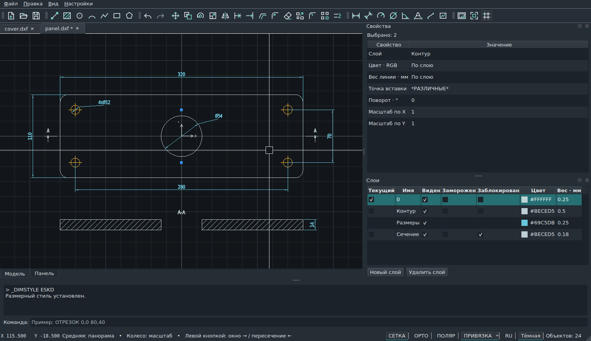
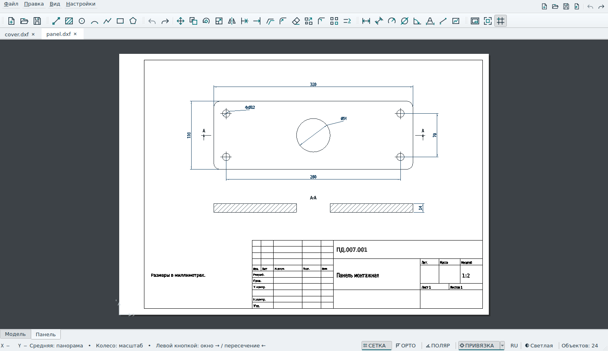

[English](README.md) · **Русский**

[](https://github.com/Alchimon-Code/FreeCAD/actions/workflows/ci.yml) [](LICENSE) [](LICENSES/MIT.txt)   

# PlaneDraft 2D



PlaneDraft — настольная 2D-САПР для Windows x64 и Linux. Геометрия редактируется в модели, масштабные виды размещаются на листе, а векторный PDF можно выпустить из того же чертежа даже без Qt и видеокарты. Это самостоятельный проект в `Alchimon-Code/FreeCAD`, а не рабочая среда upstream FreeCAD.

**Попробуйте:** откройте [panel.dxf](examples/drawings/panel.dxf), выберите центральную окружность и дважды щёлкните по **Радиусу** в доке «Свойства». Измените значение и нажмите **Ctrl+Z**. Под холстом переключитесь с **Модель** на **Панель**: на листе А4 в масштабе 1:2 ширина панели стала 160 мм, а размер по-прежнему показывает 320. На снимке сверху выбраны две вставки: у общего поля с несовпадающими значениями написано `*РАЗЛИЧНЫЕ*`.

## От модели до листа

| Сценарий | Возможности |
|---|---|
| [Модель и слои](docs/images/workspace-light-en.png) | Отрезки, окружности, дуги, полилинии с дуговыми участками и текст. Общие свойства выбора меняются одной транзакцией. Заблокированный слой запрещает правку, но не привязку. У каждой вкладки свои выбор, камера, командная строка и история отмены. |
| [Точная правка](editor/README.md) | Выбор до или после команды. Аналитические Trim/Extend по конечным границам, Offset кривых и Fillet двух отрезков с заданным радиусом. Ручки и привязки к концам, серединам, центрам, квадрантам, пересечениям, точкам вставки и ближайшей точке. F3 — привязки, F8 — Орто, F10 — полярное отслеживание. |
| [Блоки и оформление](docs/DRAWINGS.md) | Вложенные определения блоков, вставка и расчленение, штриховка замкнутых границ с островами. Линейные, параллельные, радиальные, диаметральные и угловые размеры; настройки ISO и ЕСКД. |
| [Листы](docs/images/layout-eskd.png) | Виды модели с отсечением по прямоугольнику и явным масштабом, листы А4–А1, рамка и основная надпись по образцу ЕСКД. Переключение на лист не меняет геометрию. |
| [Вывод](docs/images/pdf-output.png) | Чтение и запись поддерживаемого подмножества ASCII DXF. SVG и PDF сохраняют слои, цвета и физический вес линий. Для DWG нужны опциональные внешние конвертеры. |
| [Расширения](sdk/README.md) | Доверенная DLL/SO или [скрипт PlaneDraft Lisp](examples/scripts/pattern.pdl) получает активный документ. Изменения проходят через те же транзакции, что и встроенные команды. |



[Светлая тема и английский интерфейс](docs/images/workspace-light-en.png) · [Превью PDF при 144 dpi](docs/images/pdf-output.png) · [Как воспроизвести снимки](docs/images/README.md)

## Зачем так устроено

* **Одна модель без зависимости от окна.** [`pd_core`](core/README.md) не знает ни о Qt, ни об OpenGL. Редактор, конвертер, тесты и расширения работают с одной геометрией и одинаковыми правилами валидации. PDF строится из модели, а не из скриншота.
* **Точность при больших координатах.** [Рендерер](render/README.md) сначала вычисляет `точка − начало пакета` в `double` на CPU и только затем переводит результат в `float32`. Смещение начала пакета относительно камеры тоже рассчитывается в `double`. При панораме около `(10⁷, −10⁷)` видеокарте не приходится вычитать два уже округлённых мировых числа: для этого не нужны 64-битные шейдеры.
* **Отменяются изменения, а не вычисления.** Документ хранит неизменяемые версии сущностей (`shared_ptr<const T>`) со стабильными ID. Транзакция подготавливает замены и копирует лишь изменяемые пути персистентного R-tree. Геометрия, индекс и история становятся видны одновременно. Undo восстанавливает прежние значения без накопления ошибок обратных преобразований; неудачная правка не уничтожает Redo.
* **Плагину не нужен C++ ABI хоста.** [C ABI v2](sdk/include/planedraft/pd_plugin_api.h) передаёт таблицы с размерами, POD, непрозрачные дескрипторы и снимки данных. Сохраняется совместимость с v1. Встроенный [PlaneDraft Lisp](scripting/README.md) не требует Python, Scheme или отдельной среды исполнения.
* **Явные границы поставки.** Хост — [LGPL-2.1-or-later](LICENSE), SDK и примеры — [MIT](LICENSES/MIT.txt); динамические библиотеки Qt заменяемы. Опциональный DWG-мост передаёт DXF внешним процессам: LibreDWG не линкуется с PlaneDraft и не входит в поставку. Граница процесса сама по себе не отменяет лицензионных обязательств. См. [реестр компонентов](THIRD_PARTY_NOTICES.md) и [проверку перед выпуском](docs/LICENSING.md).

## Быстрый старт

Для интерфейса нужен драйвер настольного **OpenGL 4.5 Core**. `pdconvert` и тестам ядра он не нужен. Команды ниже выполняются из корня исходников.

### Сборка на Windows

Установите Visual Studio 2022 с **Desktop development with C++**, Windows SDK, CMake ≥ 3.24, Ninja и Git. Откройте **x64 Native Tools Command Prompt for VS 2022** (`cmd.exe`):

```bat
git clone https://github.com/microsoft/vcpkg.git ..\vcpkg
git -C ..\vcpkg checkout 84bab45d415d22042bd0b9081aea57f362da3f35
call ..\vcpkg\bootstrap-vcpkg.bat -disableMetrics
for %I in (..\vcpkg) do set "VCPKG_ROOT=%~fI"
cmake --preset windows-msvc
cmake --build --preset windows-msvc
ctest --preset windows-msvc
build\windows-msvc\bin\PlaneDraft.exe examples\drawings\panel.dxf
```

Первый configure собирает закреплённые зависимости. Для сборки без Qt есть `windows-core`. [Инструкция по Portable ZIP и установщику Inno Setup](packaging/windows/README.md); регистрация `.dxf` в «Открыть с помощью» выключена по умолчанию.

### Сборка на Linux

Нужны GCC или Clang с C++20, CMake ≥ 3.24, Ninja, GoogleTest и Qt **6.5+** с Widgets, OpenGL, OpenGLWidgets, Svg, LinguistTools и каталогом `qtbase_ru.qm`. Если Qt установлен отдельно, укажите его префикс в `CMAKE_PREFIX_PATH`.

```sh
cmake --preset linux-release
cmake --build --preset linux-release --parallel
ctest --preset linux-release
build/linux-release/bin/PlaneDraft examples/drawings/cover.dxf examples/drawings/panel.dxf
```

### Демо и выпуск PDF

В `build/<preset>/bin/` или в `bin/` готового комплекта запустите `PlaneDraft --viewport-demo` для сцены в больших координатах. `PlaneDraft --load-plugins` явно разрешает загрузить доверенные модули из соседнего `plugins/`: введите `_FRAME 100` и нажмите **Ctrl+Shift+E**. Без этого ключа каталог автоматически не сканируется. Для первого скрипта выберите **Файл → Запустить скрипт** и откройте [pattern.pdl](examples/scripts/pattern.pdl).

Из корня проекта или готового комплекта, добавив соответствующий `bin` в `PATH`:

```sh
pdconvert --layout "Панель" examples/drawings/panel.dxf panel-A4.pdf
pdconvert examples/drawings/cover.dxf cover.svg
```

[Контракт ввода-вывода и настройка DWG](io/README.md) · [Руководство по выпуску чертежа](docs/DRAWINGS.md). Неизвестные записи DXF отражаются в диагностике; сохранение произвольного стороннего файла без потерь не гарантируется. Размеры и штриховки редактируемы, но не связаны постоянными ограничениями с соседней геометрией.

## Проверка и релизы

В [GitHub Actions](https://github.com/Alchimon-Code/FreeCAD/actions/workflows/ci.yml) настроены Linux GCC/Clang с чтением реального framebuffer Mesa (100%, 150%, 200%), headless ASan/UBSan и MSVC x64. Независимый аудит проверяет структуру DXF и масштаб в растеризованном PDF. Для Windows предусмотрены запуск с чистым PATH, конвертация, установка и удаление, сверка SHA-256 **всех** файлов исполнения с `RUNTIME_INVENTORY.md`. CI не заменяет проверку драйвера на рабочей станции.

Windows v0.1.0: проверка идёт; сам рецепт упаковки ещё не подтверждает результат.

[Изменения](CHANGELOG.md) · [Релизы](https://github.com/Alchimon-Code/FreeCAD/releases) · [Карта архитектуры](ARCHITECTURE.md) · [Участие и тесты](CONTRIBUTING.ru.md)
